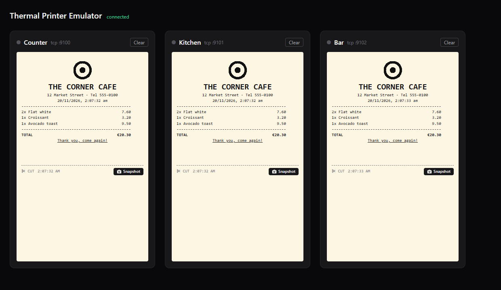
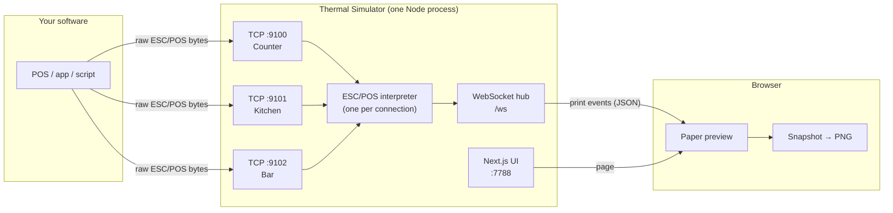
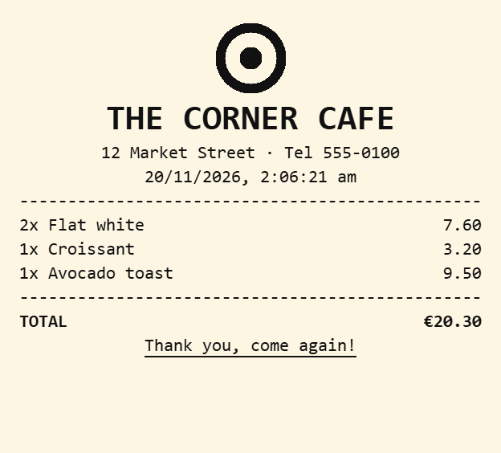

<div align="center">


# Thermal Simulator

**Virtual 80mm ESC/POS network printers with a live web preview.**

Point your POS, kitchen display or receipt code at it like a real printer, and see every receipt appear in your browser as it prints.
No hardware, no paper, no database.

[](LICENSE)




</div>

---

## Contents

- [Why](#why)
- [Features](#features)
- [Quick start](#quick-start)
- [How it works](#how-it-works)
- [Send your first print](#send-your-first-print)
- [Snapshots: save a receipt as PNG](#snapshots-save-a-receipt-as-png)
- [Configuration](#configuration)
- [Self-hosting](#self-hosting)
- [Supported ESC/POS commands](#supported-escpos-commands)
- [Project structure](#project-structure)
- [Development](#development)
- [Troubleshooting](#troubleshooting)
- [Limitations and roadmap](#limitations-and-roadmap)
- [Contributing](#contributing)
- [License](#license)

---

## Why

Building or testing anything that prints receipts usually means a real thermal printer on your desk, a roll of paper per afternoon, and running to the kitchen to see whether the KOT came out right.

Thermal Simulator puts that printer in your browser instead. It listens on the same raw TCP port (`9100`) that network receipt printers use. It understands the ESC/POS byte stream your software already sends, and it draws the result on a paper-like preview in real time. Run several of them at once, one per station.

It's useful for:

- **POS and restaurant software development**: test receipt layouts, KOTs and bar tickets without hardware.
- **QA and demos**: show printing working on a laptop, in CI screenshots, or in a sales demo.
- **Debugging**: see exactly what your app sends, including alignment, bold, double-size text, logos and cuts.
- **Sharing**: save any receipt as a PNG and drop it into a bug report or a chat.

## Features

|  |  |
|---|---|
| 🖨️ **Multiple printers** | Counter, Kitchen and Bar out of the box. Add as many as you want with one env variable. |
| ⚡ **Live preview** | Receipts stream to every open browser over WebSocket as the bytes arrive. |
| 🧾 **Real ESC/POS parsing** | Alignment, bold, underline, double size, line feeds, cuts, and raster/column bit images (logos). |
| 📸 **Snapshots** | One click saves a receipt as a printer-scale PNG (576 dots wide, the real 80mm print width). |
| 🧱 **Robust stream handling** | Commands and images split across TCP packets are reassembled correctly. Unknown commands are skipped and never printed as garbage. |
| 🗄️ **No database** | Nothing is stored on the server. Receipts live in your browser tab until you clear or refresh. |
| 🐳 **Self-hosted** | Run it with Node or Docker on a laptop, a Raspberry Pi or a LAN server. |
| 📱 **Responsive** | Keeps the 48-column receipt layout intact on phones and tablets. |

## Quick start

**Requirements:** Node.js **18.18 or newer** (22 LTS recommended).

```bash
git clone https://github.com/tejapunna/Thermal-Simulator.git
cd Thermal-Simulator
npm install

npm run dev
```

Open **http://localhost:7788**. Then, in a second terminal, print a sample receipt:

```bash
npm run demo            # → Counter  (port 9100)
npm run demo -- 9101    # → Kitchen
npm run demo -- 9102    # → Bar
```

You should see this output in the terminal running the server:

```
web + ws  http://localhost:7788  (ws path /ws)
printer Counter  tcp 0.0.0.0:9100
printer Kitchen  tcp 0.0.0.0:9101
printer Bar      tcp 0.0.0.0:9102
[counter] connected 127.0.0.1:52144
[counter] closed 127.0.0.1:52144
```

For production (optimized build):

```bash
npm run build
npm start
```

## How it works



1. **Your software connects** to a printer port over plain TCP, exactly like it would to a real Epson/Xprinter-style network printer, and writes ESC/POS bytes.
2. **Each connection gets its own interpreter** (`lib/escpos-interpreter.ts`). It's a streaming parser: it consumes bytes as they arrive, keeps any half-received command buffered until the rest shows up, and tracks printer state (alignment, bold, underline, size).
3. **The interpreter emits small events**: `line`, `image`, `cut`, `init`. A line carries its text and style, and an image carries a 1-bit bitmap.
4. **The server broadcasts** each event over a WebSocket (`/ws`) to every open browser, tagged with the printer it came from. It runs on the same port as the web UI.
5. **The browser draws** the events onto a paper-coloured roll. Cuts split the roll into individual receipts.
6. **When the connection closes**, any half-printed line is flushed and the receipt is cut, the way a real printer finishes a job.

### What one receipt looks like on the wire

```text
1B 40                 ESC @        initialize
1B 61 01              ESC a 1      center
1D 21 11              GS ! 0x11    double width + height
1B 45 01              ESC E 1      bold on
54 48 45 20 ... 0A    "THE CORNER CAFE\n"
1D 21 00 1B 45 00                  normal size, bold off
1B 61 00              ESC a 0      left
32 78 20 46 ... 0A    "2x Flat white          7.60\n"
1B 64 03              ESC d 3      feed 3 lines
1D 56 42 00           GS V B 0     feed & cut
```

### Why there's no database

The server is a pass-through: bytes in, events out. Nothing is written to disk and nothing is kept in server memory once it has been broadcast. That keeps it trivial to self-host (one process, no migrations, no volumes) and means there's no stored customer data to worry about.

The trade-off: **a receipt is only shown in browsers that are open when it prints**, and refreshing the page clears it. Use [Snapshots](#snapshots-save-a-receipt-as-png) to keep the ones you care about.

## Send your first print

Anything that can open a TCP socket can print. Here are a few common setups.

### From your POS software

Most POS and restaurant systems have a "network printer" or "LAN/Ethernet printer" setting. Enter:

| Setting | Value |
|---|---|
| IP / host | The machine running Thermal Simulator (e.g. `192.168.1.20`, or `127.0.0.1` on the same PC) |
| Port | `9100` (Counter), `9101` (Kitchen), `9102` (Bar) |
| Protocol | Raw / RAW TCP / JetDirect |
| Paper | 80 mm (48 columns) |

### As a Windows printer

1. **Settings → Bluetooth & devices → Printers & scanners → Add device → Add manually.**
2. Choose **Add a printer using an IP address or hostname**, device type **TCP/IP Device**, host `127.0.0.1` (or the server's IP).
3. Uncheck *Query the printer*, and when asked for a port type choose **Custom → Settings → Raw**, port `9100`.
4. Pick your printer vendor's ESC/POS driver (any 80 mm ESC/POS driver works), or **Generic → Generic / Text Only** for plain text.

### From the command line

```bash
# macOS / Linux
printf '\x1b@\x1ba\x01\x1bE\x01Hello printer!\n\x1bE\x00It works.\n\x1dV\x00' | nc localhost 9100
```

```powershell
# Windows PowerShell
$c = New-Object Net.Sockets.TcpClient('localhost', 9100)
$b = [Text.Encoding]::UTF8.GetBytes("Hello from PowerShell`n")
$c.GetStream().Write($b, 0, $b.Length); $c.Close()
```

### From code

**Node.js**, with [`node-thermal-printer`](https://www.npmjs.com/package/node-thermal-printer):

```js
const { ThermalPrinter, PrinterTypes } = require('node-thermal-printer');

const printer = new ThermalPrinter({ type: PrinterTypes.EPSON, interface: 'tcp://localhost:9100' });
printer.alignCenter();
printer.bold(true);
printer.println('Hello from Node');
printer.bold(false);
printer.cut();
await printer.execute();
```

**Python**, with [`python-escpos`](https://python-escpos.readthedocs.io/):

```python
from escpos.printer import Network

p = Network("localhost", port=9100)
p.set(align="center", bold=True)
p.text("Hello from Python\n")
p.cut()
p.close()
```

**Raw sockets** (any language): open TCP to `host:9100`, write bytes, close. The included [`scripts/demo.ts`](scripts/demo.ts) is a complete ~80-line example, including a bitmap logo.

## Snapshots: save a receipt as PNG

Every receipt that has been cut gets a **Snapshot** button on its cut line. Click it and the browser downloads a PNG of that receipt.

<div align="center">

</div>

- **Printer scale.** The image is 576 dots wide, the real printable width of an 80 mm head at 203 dpi, plus a small margin. Text sits on the same 48-column grid the printer uses.
- **Redrawn from print data, not a screenshot.** The PNG is rendered from the receipt's events, so it doesn't depend on your zoom level, window size or scroll position.
- **Bitmaps are pixel-exact.** Logos are drawn dot for dot with no smoothing.
- **Named for you.** Files are named `<printer>-<date>_<time>.png`, for example `kitchen-2026-11-20_14-03-09.png`.
- **Private.** Rendering happens entirely in your browser. Nothing is uploaded.

## Configuration

Everything is configured with environment variables. There is no config file.

| Variable | Default | Description |
|---|---|---|
| `PRINTERS` | `Counter:9100,Kitchen:9101,Bar:9102` | Comma-separated `Name:port` list. One virtual printer is created for each entry. |
| `PORT` | `7788` | Port for the web UI and the WebSocket (`/ws`). |
| `HOST` | `0.0.0.0` | Interface to bind. Use `127.0.0.1` to keep it local to this machine. |

Examples:

```bash
# Two printers on custom ports
PRINTERS="Front:9200,Grill:9201" npm start

# Five stations, UI on port 8080, local machine only
PRINTERS="Counter:9100,Kitchen:9101,Bar:9102,Pizza:9103,Dessert:9104" PORT=8080 HOST=127.0.0.1 npm start
```

```powershell
# Windows PowerShell
$env:PRINTERS = "Front:9200,Grill:9201"; npm start
```

The server refuses to start with a clear message if an entry is malformed or a port is already taken.

## Self-hosting

Pick whichever fits your setup. All of them run the same single process.

### Option 1: Node.js

```bash
npm ci
npm run build
npm start
```

To keep it running in the background and start it on boot, use [pm2](https://pm2.keymetrics.io/):

```bash
npm install -g pm2
pm2 start npm --name thermal-simulator -- start
pm2 save && pm2 startup
```

Or use a systemd unit (Linux, e.g. a Raspberry Pi):

```ini
# /etc/systemd/system/thermal-simulator.service
[Unit]
Description=Thermal Simulator
After=network.target

[Service]
WorkingDirectory=/opt/thermal-simulator
ExecStart=/usr/bin/npm start
Environment=PRINTERS=Counter:9100,Kitchen:9101,Bar:9102
Restart=on-failure
User=thermal

[Install]
WantedBy=multi-user.target
```

```bash
sudo systemctl enable --now thermal-simulator
```

### Option 2: Docker Compose

```bash
docker compose up -d --build
```

The included [`docker-compose.yml`](docker-compose.yml) publishes the web UI on `7788` and the printers on `9100–9102`. If you change `PRINTERS`, update the `ports:` mapping to match.

### Option 3: Docker

```bash
docker build -t thermal-simulator .
docker run -d --name thermal-simulator --init --restart unless-stopped \
  -p 7788:7788 -p 9100-9102:9100-9102 \
  thermal-simulator
```

### Reaching it from other devices on your network

To let a POS tablet or another PC print to it:

1. Find the server's LAN IP (`ipconfig` on Windows, `ip a` on Linux, `ipconfig getifaddr en0` on macOS).
2. Point the device at `that-ip:9100` and open `http://that-ip:7788` in any browser.
3. Allow the ports through the firewall if needed:

```powershell
# Windows (run as Administrator)
New-NetFirewallRule -DisplayName "Thermal Simulator" -Direction Inbound -Protocol TCP -LocalPort 7788,9100-9102 -Action Allow
```

```bash
# Ubuntu / Debian with ufw
sudo ufw allow 7788,9100:9102/tcp
```

### Behind a reverse proxy

The UI connects to the WebSocket on the same host and port it was loaded from, so a reverse proxy works as long as it forwards WebSocket upgrades. Example for nginx:

```nginx
location / {
    proxy_pass http://127.0.0.1:7788;
    proxy_http_version 1.1;
    proxy_set_header Upgrade $http_upgrade;
    proxy_set_header Connection "upgrade";
    proxy_set_header Host $host;
}
```

The printer ports are raw TCP, not HTTP, so they can't go through an HTTP proxy. Expose them directly, or use a TCP (stream) proxy.

> [!WARNING]
> **There is no authentication.** Anyone who can reach the web port can watch every receipt, and anyone who can reach a printer port can print. Run it on a trusted LAN or bind to `127.0.0.1`. Don't expose it to the public internet without putting authentication in front of it.

## Supported ESC/POS commands

| Command | Bytes | Effect |
|---|---|---|
| Initialize | `ESC @` | Resets alignment, bold, underline and size |
| Align | `ESC a n` | `0` left, `1` center, `2` right |
| Bold | `ESC E n` | On when the low bit of `n` is set |
| Underline | `ESC - n` | `1`/`2` on, `0` off (ASCII `'0'` also accepted) |
| Character size | `GS ! n` | Any width/height multiplier other than 1× is drawn as double size |
| Print & feed | `ESC d n` | Prints the buffer, then feeds `n` blank lines |
| Line feed | `LF` (`0x0A`) | Prints the current line |
| Cut | `GS V m` / `GS V m n` | Full or partial cut, with or without feed |
| Cut (legacy) | `ESC i` / `ESC m` | Cut |
| Raster image | `GS v 0 m xL xH yL yH d…` | Drawn as a bitmap. This is what most POS libraries use for logos |
| Column image | `ESC * m nL nH d…` | 8- and 24-dot modes, converted to a bitmap |
| Barcode | `GS k …` | Consumed safely, not drawn (yet) |
| QR / 2D codes, page-mode graphics | `GS ( …`, `GS 8 L …` | Consumed safely, not drawn (yet) |
| Downloaded bit image | `GS * x y d…` | Consumed safely |
| Anything else | `ESC x n`, `GS x n` | Skipped, assuming one parameter byte, so the bytes never show up as text |

Text is decoded as **UTF-8**. `CR`, `TAB` and other control bytes are ignored.

## Project structure

```text
thermal-simulator/
├── server.ts                      # HTTP + WebSocket + one TCP server per printer
├── lib/
│   ├── escpos-interpreter.ts      # streaming ESC/POS parser → print events
│   ├── escpos-interpreter.test.ts
│   ├── receipt.ts                 # split the roll into receipts, column wrapping
│   ├── receipt.test.ts
│   └── snapshot.ts                # draw a receipt to a 576-dot canvas → PNG
├── app/
│   ├── page.tsx                   # the live paper preview UI
│   ├── layout.tsx
│   ├── globals.css
│   └── icon.svg
├── scripts/
│   └── demo.ts                    # sends a sample receipt (npm run demo)
├── docs/                          # README images
├── Dockerfile
└── docker-compose.yml
```

## Development

```bash
npm run dev         # dev server with hot reload on :7788
npm test            # interpreter + receipt tests
npm run typecheck   # strict TypeScript check
npm run build       # production build (also type-checks)
```

The tests are plain `node:assert` scripts run with `tsx`, with no test framework to install. They cover the cases that break real printer emulators: commands and images split across TCP chunks, multi-byte UTF-8 split across chunks, unknown commands, and barcode/QR payloads that must not leak into the text.

**Adding a new command:** add a `case` in `esc()` or a branch in `gs()` in `lib/escpos-interpreter.ts`. Return `0` when you need more bytes, otherwise return the number of bytes the command used. Add an assertion to `escpos-interpreter.test.ts` that feeds the command split across chunks.

## Troubleshooting

<details>
<summary><b>"cannot listen on :9100 — EADDRINUSE"</b></summary>

Something else is already using that port: another copy of the simulator, a printer driver, or a print server. Stop it, or move the simulator to other ports with `PRINTERS="Counter:9200,Kitchen:9201"`.
</details>

<details>
<summary><b>The page says "reconnecting…"</b></summary>

The browser can't reach the WebSocket. Check that the server is running, that you opened the same host and port the server printed, and if you use a reverse proxy, that it forwards `Upgrade` headers (see above).
</details>

<details>
<summary><b>My POS says the print succeeded but nothing appears</b></summary>

- Make sure the browser tab was open when you printed. Receipts aren't stored.
- Check the server terminal for a `[counter] connected …` line. If there isn't one, the POS isn't reaching the port (wrong IP or port, or a firewall).
- Some POS software waits for status replies from the printer (`DLE EOT`). The simulator doesn't answer those yet, so the POS may time out.
</details>

<details>
<summary><b>Accented characters or symbols look wrong</b></summary>

The simulator decodes text as UTF-8. If your software sends a legacy code page (CP437, CP850, CP1252, …), non-ASCII characters will be wrong. Plain ASCII always works.
</details>

<details>
<summary><b>Logo is missing or looks like noise</b></summary>

Raster (`GS v 0`) and column (`ESC *`) images are supported. Images sent as `GS ( L` or `GS 8 L` (page-mode / NV graphics) are skipped for now.
</details>

## Limitations and roadmap

Not supported yet. Contributions are welcome:

- [ ] Draw barcodes (`GS k`) and QR codes (`GS ( k`)
- [ ] Code page support (`ESC t`) for CP437 / CP850 / CP1252
- [ ] Separate 2× width and 2× height (currently any enlargement is drawn as double size)
- [ ] Printer status replies (`DLE EOT`, `GS r`) for POS software that polls
- [ ] Double-size mode for raster images
- [ ] 58 mm (32-column) paper option
- [ ] Optional history that survives a page refresh

## Contributing

Issues and pull requests are welcome.

1. Fork and create a branch: `git checkout -b feature/qr-codes`
2. Make your change and add a test for it
3. Run `npm test && npm run build`
4. Open a pull request with a short description and, if it changes what gets printed, a snapshot PNG

If you're reporting a rendering bug, the most useful thing to attach is the raw bytes your software sends. You can capture them with `nc -l 9100 > job.bin`.

## License

[MIT](LICENSE). Free to use, modify and distribute.
